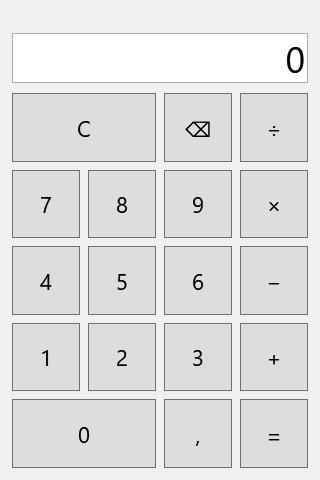
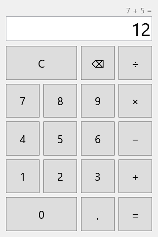
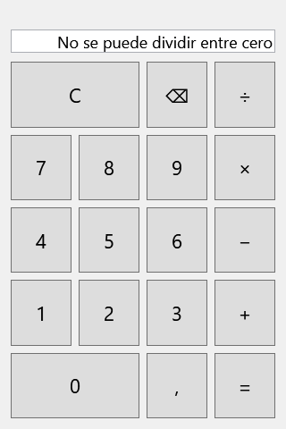
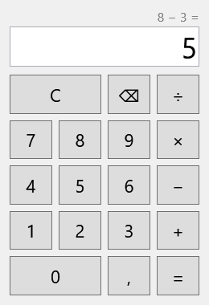
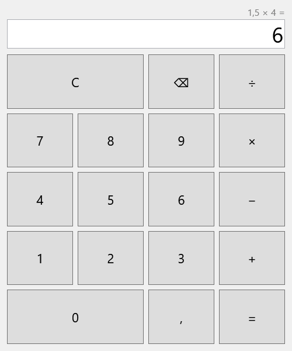

# E01 · Calculadora con el editor visual

Aplicación de calculadora de cuatro operaciones desarrollada con **WPF**, **.NET 10** y **C#**, con interfaz responsiva basada en `Grid`, maquetación limpia en XAML, estilos compartidos, accesibilidad y soporte completo tanto por ratón como por teclado.

---

## Capturas

### 1. Estado inicial de la calculadora (320 × 480)
Ventana principal con tamaño por defecto, mostrando el valor inicial `0` en la pantalla y todos los botones distribuidos proporcionalmente:



### 2. Operación y resultado (`7 + 5 = 12`)
Muestra de la operación pendiente en `txtOperacion` (`7 + 5 =`) y el resultado calculado en `txtPantalla` (`12`):



### 3. Control de división entre cero (`9 ÷ 0 =`)
Al intentar dividir por cero se muestra el mensaje de error `No se puede dividir entre cero`. Al introducir una nueva cifra se inicia un nuevo número automáticamente:



### 4. Tamaño mínimo permitido (260 × 380)
La ventana respeta las dimensiones mínimas (`MinWidth="260"`, `MinHeight="380"`), manteniendo todos los botones legibles y accesibles sin desbordamiento:



### 5. Adaptabilidad responsiva al redimensionar
Al agrandar la ventana, los botones crecen proporcionalmente ocupando todo el espacio disponible, mientras que la pantalla se mantiene fija en la parte superior:



---

## El código que generó el diseñador

Al arrastrar un botón desde el *Cuadro de herramientas* de Visual Studio y soltarlo sobre el lienzo del diseñador gráfico, se genera automáticamente el siguiente fragmento XAML:

```xaml
<Button Content="Button" HorizontalAlignment="Left" Margin="24,115,0,0" VerticalAlignment="Top" Width="76" Height="46"/>
```

### Análisis crítico del código generado por el diseñador:

1. **Márgenes calculados (`Margin="24,115,0,0"`)**:
   - El diseñador simula un posicionamiento absoluto fijando las coordenadas superior e izquierda mediante márgenes rígidos.
   - **Problema**: Si el usuario redimensiona la ventana o la resolución/DPI de la pantalla cambia, los controles permanecen en posiciones estáticas, pudiendo solaparse o quedar fuera del área visible.

2. **Alineaciones restrictivas (`HorizontalAlignment="Left"`, `VerticalAlignment="Top"`)**:
   - Fuerzan al control a situarse en la esquina superior izquierda de su contenedor.
   - **Problema**: Impide que el control aproveche la elasticidad nativa del motor de diseño de WPF para expandirse en su celda.

3. **Dimensiones fijas (`Width="76"`, `Height="46"`)**:
   - Fijan un ancho y alto explícito e inmutable para cada control individual.
   - **Problema**: Los botones no se adaptan al espacio disponible al maximizar o estirar la ventana.

4. **Falta de reutilización de estilos**:
   - Si se arrastran 18 botones, propiedades comunes como el margen interior, la tipografía o el tamaño de fuente se duplican 18 veces en el XAML, dificultando el mantenimiento.

### Qué se ha cambiado y por qué:

- **Eliminación de coordenadas absolutas**: Se suprimieron todos los atributos `Margin`, `Width`, `Height`, `HorizontalAlignment` y `VerticalAlignment` de los botones.
- **Posicionamiento relativo mediante `Grid`**: Cada botón se posiciona usando `Grid.Row`, `Grid.Column` y `Grid.ColumnSpan`.
- **Dimensiones proporcionales (`*`)**: Las 5 filas de botones y las 4 columnas del `Grid` se definen con tamaño relativo `*`, permitiendo que los botones crezcan o encojan simétricamente.
- **Estilo centralizado en `Window.Resources`**: Se creó un estilo global para los botones con `Margin="4"` y `FontSize="22"`, garantizando separación homogénea y tipografía uniforme sin repetir código.

---

## Distribución

La maquetación se implementó utilizando un único `Grid` raíz con un margen exterior de 8 (`Margin="8"`), compuesto por **4 columnas de ancho igual (`*`)** y **7 filas**:
- **Filas 0 y 1 (`Height="Auto"`)**: Para la pantalla superior.
- **Filas 2 a 6 (`Height="*"`)**: Para la botonera de 18 elementos interactivos.

### Tabla de distribución de controles en el Grid

| Fila | Altura | Columna(s) | Control | Nombre (`x:Name`) | Propiedades destacadas |
| :---: | :---: | :---: | :--- | :--- | :--- |
| **0** | `Auto` | 0 a 3 (Span 4) | `TextBlock` | `txtOperacion` | `Foreground="Gray"`, `FontSize="16"`, `TextAlignment="Right"`, `Margin="4,2"` |
| **1** | `Auto` | 0 a 3 (Span 4) | `TextBox` | `txtPantalla` | `IsReadOnly="True"`, `FontSize="36"`, `TextAlignment="Right"`, `Text="0"`, `AutomationProperties.Name="Resultado"` |
| **2** | `*` | 0 a 1 (Span 2) | `Button` | `btnBorrar` | `Content="C"`, `Click="btnBorrar_Click"` |
| **2** | `*` | 2 | `Button` | `btnRetroceso` | `Content="⌫"`, `Click="btnRetroceso_Click"`, `AutomationProperties.Name="Borrar la última cifra"` |
| **2** | `*` | 3 | `Button` | *(anónimo)* | `Content="÷"`, `Click="btnOperacion_Click"` |
| **3** | `*` | 0 | `Button` | *(anónimo)* | `Content="7"`, `Click="btnDigito_Click"` |
| **3** | `*` | 1 | `Button` | *(anónimo)* | `Content="8"`, `Click="btnDigito_Click"` |
| **3** | `*` | 2 | `Button` | *(anónimo)* | `Content="9"`, `Click="btnDigito_Click"` |
| **3** | `*` | 3 | `Button` | *(anónimo)* | `Content="×"`, `Click="btnOperacion_Click"` |
| **4** | `*` | 0 | `Button` | *(anónimo)* | `Content="4"`, `Click="btnDigito_Click"` |
| **4** | `*` | 1 | `Button` | *(anónimo)* | `Content="5"`, `Click="btnDigito_Click"` |
| **4** | `*` | 2 | `Button` | *(anónimo)* | `Content="6"`, `Click="btnDigito_Click"` |
| **4** | `*` | 3 | `Button` | *(anónimo)* | `Content="−"`, `Click="btnOperacion_Click"` |
| **5** | `*` | 0 | `Button` | *(anónimo)* | `Content="1"`, `Click="btnDigito_Click"` |
| **5** | `*` | 1 | `Button` | *(anónimo)* | `Content="2"`, `Click="btnDigito_Click"` |
| **5** | `*` | 2 | `Button` | *(anónimo)* | `Content="3"`, `Click="btnDigito_Click"` |
| **5** | `*` | 3 | `Button` | *(anónimo)* | `Content="+"`, `Click="btnOperacion_Click"` |
| **6** | `*` | 0 a 1 (Span 2) | `Button` | *(anónimo)* | `Content="0"`, `Click="btnDigito_Click"` |
| **6** | `*` | 2 | `Button` | `btnComa` | `Content=","`, `Click="btnComa_Click"` |
| **6** | `*` | 3 | `Button` | `btnIgual` | `Content="="`, `Click="btnIgual_Click"` |

### Accesibilidad

- Se configuró `AutomationProperties.Name="Borrar la última cifra"` en el botón `btnRetroceso` para que los lectores de pantalla puedan anunciar claramente la acción del símbolo `⌫`.
- Se configuró `AutomationProperties.Name="Resultado"` en el cuadro `txtPantalla` para identificar el área del valor actual.

---

## Pruebas realizadas

Se realizaron las pruebas funcionales y de maquetación exigidas en la especificación, comprobando tanto el correcto funcionamiento aritmético como el comportamiento visual:

| # | Secuencia de entrada | Resultado esperado | Resultado obtenido | Estado |
| :---: | :--- | :--- | :--- | :---: |
| **1** | `7`, `+`, `5`, `=` | Pantalla: `12`<br>Encima: `7 + 5 =` | Pantalla: `12`<br>Encima: `7 + 5 =` | ✅ Correcto |
| **2a** | `1`, `,`, `5`, `×`, `4`, `=` | Pantalla: `6` (sin ceros decimales superfluos como `6,0`) | Pantalla: `6` | ✅ Correcto |
| **2b** | `0`, `,`, `1`, `+`, `0`, `,`, `2`, `=` | Pantalla: `0,3` (precisión exacta sin errores binarios de coma flotante) | Pantalla: `0,3` | ✅ Correcto |
| **3** | `8`, `−`, `3`, `−`<br>luego `2`, `=` | Tras segundo `−`: pantalla `5` y encima `5 −`<br>Tras `2 =`: pantalla `3` y encima `5 − 2 =` | Pantalla intermedia: `5`, arriba `5 −`<br>Resultado final: `3`, arriba `5 − 2 =` | ✅ Correcto |
| **4** | `9`, `÷`, `0`, `=`<br>luego pulsar `4` | Pantalla: `No se puede dividir entre cero`<br>Al pulsar `4`, empieza número nuevo: `4` | Pantalla: `No se puede dividir entre cero`<br>Al pulsar `4`, pantalla: `4` | ✅ Correcto |
| **5** | Escribir `123`<br>pulsar `⌫` dos veces<br>pulsar `⌫` tercera vez<br>pulsar `⌫` tras un `=` | Tras 2 veces: `1`<br>Tercera vez: `0`<br>Tras un `=`, `⌫` no altera el resultado | Tras 2 veces: `1`<br>Tercera vez: `0`<br>Tras un `=`, no borra nada | ✅ Correcto |
| **6** | Pulsar `,` dos veces seguidas | `0,` (solo una coma permitida por número) | `0,` | ✅ Correcto |
| **7** | Redimensionamiento de ventana | Botones crecen proporcionalmente; pantalla fija arriba; a 260 × 380 todo visible | Se adapta de forma fluida sin recortes ni espacios vacíos | ✅ Correcto |
| **8** | Esquema del documento | Todos los botones cuelgan directamente del `Grid` | Verificado: 18 botones y 2 controles hijos directos del `Grid` | ✅ Correcto |
| **9** | Limpieza de XAML | `Width`, `Height` y `Margin` solo en Window, Grid, Style y pantalla | Comprobado mediante análisis de XAML: ningún botón contiene dichos atributos | ✅ Correcto |
| **10** | Manejo de teclado *(desafío)* | Cifras (0-9, NumPad), `,`, `.`, `+`, `-`, `*`, `/`, `Enter`, `Back`, `Esc`/`C` | Todas las teclas ejecutan los mismos métodos y funcionan idénticamente | ✅ Correcto |
