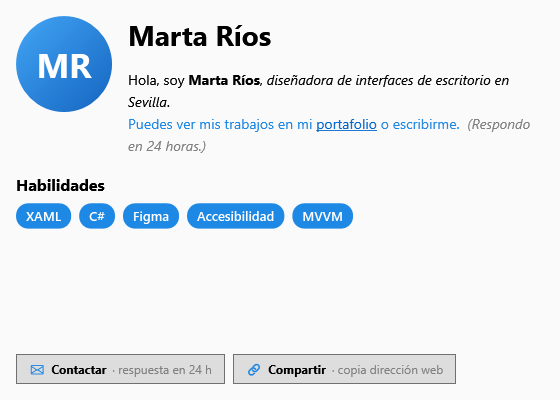
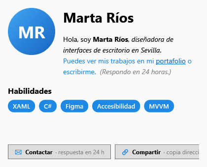
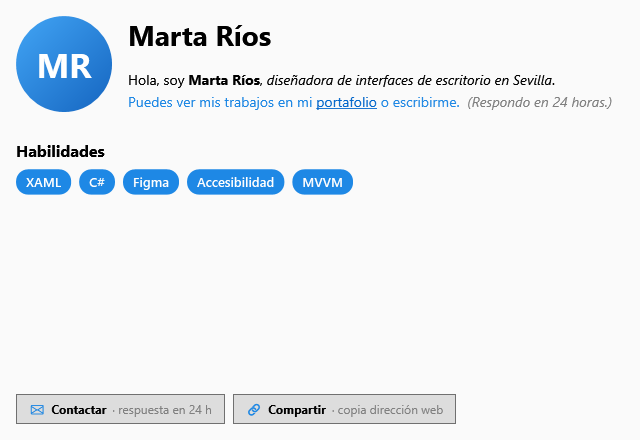

# E02 · Tarjeta de presentación

Aplicación desarrollada en **WPF**, **.NET 10** y **C#** que implementa una tarjeta de presentación interactiva para una profesional ficticia (**Marta Ríos**, diseñadora de interfaces de escritorio en Sevilla). El proyecto combina maquetación declarativa manual en XAML, generación dinámica de componentes desde C#, recursos y estilos centralizados, accesibilidad y un análisis exhaustivo del código generado por el compilador de WPF (`MainWindow.g.cs`).

---

## Capturas

### 1. Vista completa de la tarjeta de presentación (560 × 400)
Muestra la composición general: avatar con degradado lineal, presentación con texto enriquecido e hipervínculo activo, etiquetas de habilidades cargadas dinámicamente desde C# y la botonera de acciones compuestas:



### 2. Comportamiento responsivo con ventana reducida (420 × 340)
Al estrechar la ventana hasta las dimensiones mínimas, el texto de presentación salta de línea limpiamente (`TextWrapping="Wrap"`) y las etiquetas se reorganizan automáticamente en filas adicionales gracias al `WrapPanel`:



### 3. Vista en resolución ampliada (640 × 440)
Comprobación de la flexibilidad del contenedor `Grid` y la consistencia visual de los estilos aplicados:



---

## XAML frente a C#

En este ejercicio se construyen dos botones con la misma estructura y apariencia visual, pero empleando dos paradigmas diferentes:
- `btnContactar`: Declarado estáticamente en **XAML**.
- `CrearBotonCompartir()`: Construido imperativamente en **C#**.

### Tabla comparativa de sintaxis y mecanismos

| Aspecto | XAML (`btnContactar`) | C# (`CrearBotonCompartir()`) | Líneas XAML | Líneas C# |
| :--- | :--- | :--- | :---: | :---: |
| **Instanciación del botón** | `<Button x:Name="btnContactar" ...>` | `var boton = new Button();` | 1 | 4 |
| **Asignación de estilo** | `Style="{StaticResource BotonTarjeta}"` | `boton.Style = (Style)FindResource("BotonTarjeta");` | 1 | 3 |
| **Contenedor interno** | `<StackPanel Orientation="Horizontal">` | `var panelContenido = new StackPanel { Orientation = Orientation.Horizontal };` | 1 | 4 |
| **Icono con color temático** | `<TextBlock Text="✉" Foreground="{StaticResource ColorTarjeta}" Margin="0,0,6,0" />` | `var icono = new TextBlock { Text = "🔗", Foreground = (Brush)FindResource("ColorTarjeta"), Margin = new Thickness(0, 0, 6, 0) };` | 3 | 6 |
| **Texto principal en negrita** | `<TextBlock Text="Contactar" FontWeight="Bold" Margin="0,0,6,0" />` | `var textoTitulo = new TextBlock { Text = "Compartir", FontWeight = FontWeights.Bold, Margin = new Thickness(0, 0, 6, 0) };` | 3 | 6 |
| **Texto secundario en gris** | `<TextBlock Text="· respuesta en 24 h" Foreground="Gray" />` | `var textoSubtitulo = new TextBlock { Text = "· copia dirección web", Foreground = Brushes.Gray };` | 2 | 4 |
| **Jerarquía y anidamiento** | Cierre de etiquetas XML (`</StackPanel>`, `</Button>`) | `panelContenido.Children.Add(...);`<br>`boton.Content = panelContenido;` | 2 | 5 |
| **Asociación de evento** | `Click="btnContactar_Click"` | `boton.Click += btnCompartir_Click;` | 1 | 1 |
| **Líneas totales de código** | **14 líneas** (declarativas y legibles) | **33 líneas** (imperativas con asignaciones explícitas) | **14** | **33** |

---

### Elementos en el Árbol Visual Activo

Al examinar ambos botones en tiempo de ejecución mediante la herramienta **Árbol visual activo** de Visual Studio, se observa que ambos generan exactamente la misma jerarquía de nodos visuales:

```text
Button
└── ButtonChrome (o Border de la plantilla por defecto del sistema)
    └── ContentPresenter
        └── StackPanel (Horizontal)
            ├── TextBlock (Icono)
            ├── TextBlock (Texto principal en negrita)
            └── TextBlock (Texto secundario en gris)
```

Tanto el botón declarado en XAML como el construido en C# producen la misma estructura de controles e interactividad.

---

### ¿Cuándo usar cada forma?

* **Usar XAML cuando:**
  - La interfaz o sus componentes son estáticos o conocidos en tiempo de diseño.
  - Se desea mantener una separación estricta entre presentación gráfica y lógica de negocio (patrón MVVM).
  - Se definen jerarquías complejas, temas, estilos, plantillas (`ControlTemplate`, `DataTemplate`), transformaciones o animaciones.
  - Se busca máxima legibilidad, mantenibilidad y concisión en el código de interfaz.

* **Usar C# cuando:**
  - Los controles o su cantidad se desconocen en diseño y deben crearse dinámicamente en tiempo de ejecución según datos variables (por ejemplo, las etiquetas de `CrearEtiquetas()`).
  - Se desarrollan controles personalizados que deben inyectar elementos visuales algorítmicamente.
  - Se implementan arquitecturas basadas en complementos (plugins) donde la interfaz se genera desde ensamblados externos.

---

## Lo que genera el compilador

Al compilar la aplicación, la herramienta `PresentationBuildTasks` procesa el archivo `MainWindow.xaml` y genera una clase parcial complementaria en el archivo intermedio:
`obj/Debug/net10.0-windows/MainWindow.g.cs`

### 1. Campos generados en la clase parcial

El compilador genera únicamente los siguientes campos miembro privados:

```csharp
internal System.Windows.Controls.TextBlock txtPresentacion;
internal System.Windows.Controls.WrapPanel pnlHabilidades;
internal System.Windows.Controls.StackPanel pnlBotones;
internal System.Windows.Controls.Button btnContactar;
```

#### ¿Por qué el avatar no tiene ningún campo generado?
El avatar está compuesto por un `Grid`, un `Ellipse` y un `TextBlock`, pero **ninguno de ellos tiene el atributo `x:Name` o `Name`**. 
El compilador XAML solo crea un campo miembro en C# para aquellos elementos a los que el desarrollador ha asignado un nombre explícito porque necesita acceder a ellos desde el código subyacente (*code-behind*). Los elementos anónimos son creados e integrados en el árbol visual durante la deserialización del BAML, pero no requieren una referencia persistente en la clase.

---

### 2. Qué hace `InitializeComponent()`

El método generado realiza las siguientes tareas fundamentales:

```csharp
public void InitializeComponent() {
    if (_contentLoaded) {
        return;
    }
    _contentLoaded = true;
    System.Uri resourceLocater = new System.Uri("/Tarjeta;component/mainwindow.xaml", System.UriKind.Relative);
    System.Windows.Application.LoadComponent(this, resourceLocater);
}
```

1. **Evita ejecuciones redundantes**: Usa la bandera booleana `_contentLoaded` para asegurar que la inicialización solo se ejecute una vez.
2. **Localiza el recurso BAML precompilado**: Crea un `Uri` relativo empaquetado (`/Tarjeta;component/mainwindow.xaml`) que apunta al recurso binario BAML incrustado en el ensamblado.
3. **Construye el árbol de objetos**: `Application.LoadComponent()` carga el BAML, instancia los controles WPF, resuelve los recursos (`StaticResource`), inicializa las propiedades de dependencia y enlaza eventos y nombres llamando al método `Connect()`.

---

### 3. La línea de `Connect()` que asocia `btnContactar_Click`

Dentro de la implementación de la interfaz `IComponentConnector.Connect(int connectionId, object target)` generada por el compilador:

```csharp
case 5:
this.btnContactar = ((System.Windows.Controls.Button)(target));
#line 105 "..\..\..\MainWindow.xaml"
this.btnContactar.Click += new System.Windows.RoutedEventHandler(this.btnContactar_Click);
#line default
#line hidden
return;
```

#### Comparación con el operador `+=` de C#:
* En `CrearBotonCompartir()` en C#:
  ```csharp
  boton.Click += btnCompartir_Click;
  ```
* En `MainWindow.g.cs` generado desde XAML:
  ```csharp
  this.btnContactar.Click += new System.Windows.RoutedEventHandler(this.btnContactar_Click);
  ```
**Conclusión**: XAML no tiene un mecanismo mágico independiente para los eventos; el compilador XAML traduce literalmente el atributo declarativo `Click="btnContactar_Click"` en una suscripción canónica mediante un delegado `RoutedEventHandler` asociado con `+=`, exactamente igual a como lo escribimos manualmente en C#.

---

## Pruebas realizadas

| # | Prueba realizada | Procedimiento | Resultado esperado | Resultado obtenido | Estado |
| :---: | :--- | :--- | :--- | :--- | :---: |
| **1** | **Formato de texto enriquecido** | Inspección visual de `txtPresentacion` | Nombre en negrita, profesión en cursiva, salto de línea, texto en color corporativo y texto final en gris y cursiva | Textos formateados con `<Bold>`, `<Italic>`, `<LineBreak>`, `<Span>` y `<Run>` según especificación | ✅ Correcto |
| **2** | **Prioridad de Dependency Properties** | Mover el último `<Run>` (gris) dentro del `<Span>` azul | El texto sigue mostrándose en color gris a pesar de estar dentro del `Span` | Sigue gris: el valor local asignado a nivel de elemento tiene mayor precedencia en WPF que la herencia de propiedades del contenedor padre | ✅ Correcto |
| **3** | **Apertura de hipervínculo** | Clic en el enlace `portafolio` | Se dispara `Hyperlink_RequestNavigate` y se abre el navegador en `https://example.org/martarios` | Abre el navegador predeterminado mediante `Process.Start` con `UseShellExecute = true` | ✅ Correcto |
| **4** | **Botón Contactar** | Clic en el botón `btnContactar` | Aparece un cuadro de diálogo con el correo electrónico | Muestra `MessageBox` con `marta.rios@example.org` | ✅ Correcto |
| **5** | **Botón Compartir y portapapeles** | Clic en `Compartir` y pegar con Ctrl+V en un editor | La dirección web se copia al portapapeles y se muestra aviso | `Clipboard.SetText` copia `https://example.org/martarios`; verificado pegando el contenido | ✅ Correcto |
| **6** | **Equivalencia de botones** | Comparación visual de ambos botones | Misma altura, márgenes, padding, tipografía y comportamiento, cambiando solo icono y texto | Ambos botones lucen y se comportan de forma idéntica | ✅ Correcto |
| **7** | **Adaptabilidad y redimensionamiento** | Reducir el ancho de la ventana a 420 px | El texto salta de línea y las etiquetas del `WrapPanel` fluyen a la siguiente fila | Verificado: diseño flexible sin recortes ni desbordamiento | ✅ Correcto |
| **8** | **Recurso centralizado `ColorTarjeta`** | Modificar el color del recurso `ColorTarjeta` en XAML | Cambian simultáneamente el texto del `Span`, los iconos de ambos botones y las 5 etiquetas | Todos los elementos dependientes del recurso actualizan su tonalidad en bloque | ✅ Correcto |
| **9** | **Eliminación de `x:Name` en `pnlHabilidades`** | Borrar temporalmente `x:Name="pnlHabilidades"` y compilar | Error de compilación porque el compilador no genera el campo en `MainWindow.g.cs` | Error `CS0103: El nombre 'pnlHabilidades' no existe en el contexto actual`. Tras restaurarlo compila perfectamente | ✅ Correcto |
| **10** | **Desafío opcional (Avatar en C#)** | Implementar método `CrearAvatarEnCodigo()` | Genera el mismo avatar con degradado lineal programático | Requiere 37 líneas en C# frente a 14 en XAML, confirmando la superioridad declarativa de XAML para gráficos vectoriales | ✅ Correcto |
