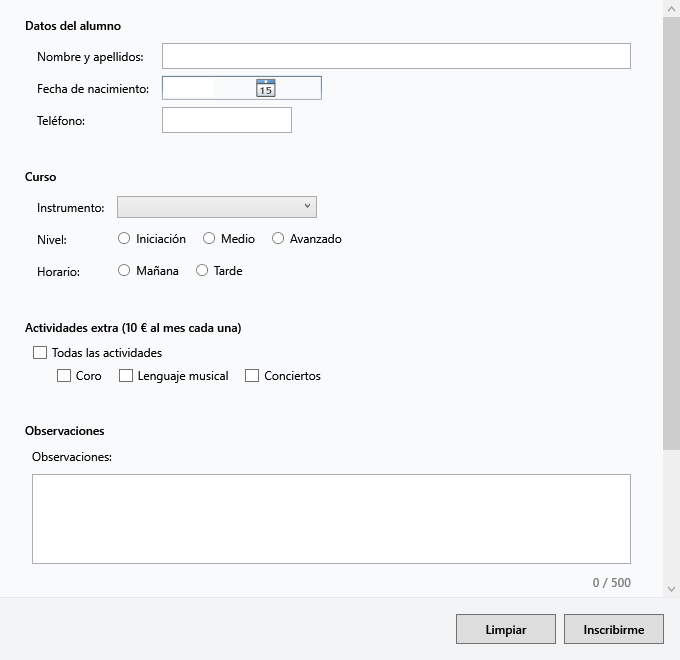
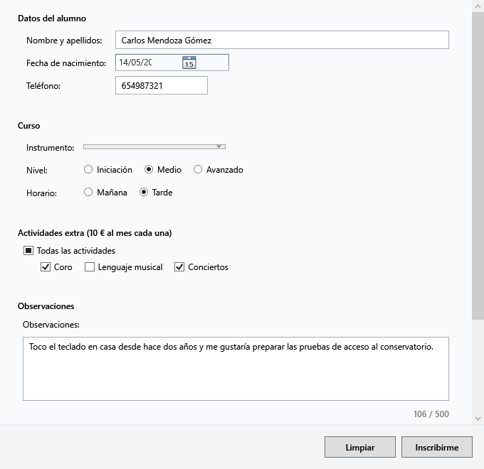
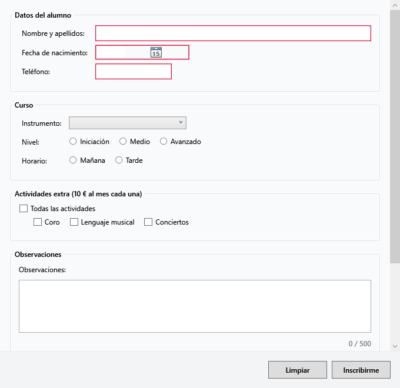
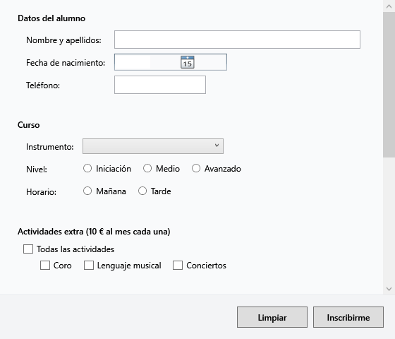

# E03 · Inscripción en la escuela de música

Formulario integral de inscripción desarrollado con **WPF**, **.NET 10** y **C#** para una escuela de música. La aplicación aplica controles especializados para cada tipo de dato, maquetación adaptable con `ScrollViewer`, imágenes incrustadas como recursos de compilación, casillas de verificación coordinadas con estado indeterminado, campo multilínea con corrector ortográfico en español y contador interactivo de caracteres, validación simultánea con detección de errores, teclas de acceso mnemónicas sin colisiones y accesibilidad para tecnologías de asistencia.

---

## Capturas

### 1. Formulario en estado inicial (680 × 660)
Vista general de la interfaz con sus 5 `GroupBox` estructurados, estilos implícitos de espaciado y botones de acción anclados en la barra inferior:

### 2. Formulario rellenado y casilla de tres estados
Cumplimentación de datos (Piano, nivel Medio, horario de Tarde, Coro y Conciertos). Se aprecia el estado indeterminado (cuadrado negro) en la casilla `Todas las actividades` al haber seleccionado dos de las tres opciones, así como el contador dinámico de observaciones (`106 / 500`):

### 3. Validación de errores y realce visual (Desafío opcional)
Al intentar inscribirse con campos vacíos o incorrectos, el formulario resalta los bordes en rojo (`BorderBrush = Crimson`), muestra un único aviso con la lista consolidada de errores y sitúa el foco en el primer campo erróneo:

### 4. Adaptabilidad y ScrollViewer en tamaño mínimo (560 × 480)
Al reducir la altura de la ventana por debajo de las dimensiones del contenido, se activa de forma automática la barra de desplazamiento vertical del `ScrollViewer`, manteniendo la barra inferior con los botones siempre fija y visible:

---

## Controles y propiedades

Para cada dato del formulario se seleccionó el control más adecuado de la biblioteca de controles de WPF, justificando sus propiedades de configuración:

| Sección | Dato | Control | Propiedades destacadas | Justificación técnica |
| :--- | :--- | :--- | :--- | :--- |
| **Datos del alumno** | Nombre y apellidos | `TextBox` (`txtNombre`) | `MaxLength="80"` | Permite texto libre acotando la longitud máxima para coincidir con la persistencia en base de datos. |
| | Fecha de nacimiento | `DatePicker` (`dtpNacimiento`) | `DisplayDateEnd = DateTime.Today` | Control nativo con calendario desplegable. Se inhabilita en el constructor la selección de cualquier fecha futura. |
| | Teléfono | `TextBox` (`txtTelefono`) | `MaxLength="9"`, `Width="130"`, `ToolTip="Nueve cifras, sin espacios"` | Campo numérico corto restringido a 9 caracteres con texto de ayuda contextual para el usuario. |
| **Curso** | Instrumento | `ComboBox` (`cmbInstrumento`) | `AutomationProperties.Name="Instrumento"` | Lista desplegable cerrada con 4 `ComboBoxItem`. Cada ítem contiene un `StackPanel` con la imagen del instrumento (24 × 24), el nombre y un `ToolTip` descriptivo. El nombre se guarda en `Tag`. Las imágenes están incrustadas con **Acción de compilación = Recurso** (`<Resource Include="Imagenes\*.png" />`). |
| | Nivel | `RadioButton` (`rbIniciacion`, `rbMedio`, `rbAvanzado`) | `GroupName="Nivel"` | Opciones mutuamente excluyentes agrupadas lógicamente bajo la categoría de nivel formativo. |
| | Horario | `RadioButton` (`rbManana`, `rbTarde`) | `GroupName="Horario"` | Opciones excluyentes independientes del grupo anterior mediante un `GroupName` diferenciado. |
| **Actividades extra** | Todas las actividades | `CheckBox` (`chkTodas`) | `IsThreeState="True"`, `Click="chkTodas_Click"` | Casilla maestra de tres estados: marcada (todas activas), desmarcada (ninguna activa) e indeterminada (algunas activas). |
| | Coro, Lenguaje, Conciertos | `CheckBox` (`chkCoro`, `chkLenguaje`, `chkConciertos`) | `Margin` con sangría de 24 px, `Click="chkExtra_Click"` | Casillas individuales con sangría visual. Comparten un único manejador que actualiza el estado de `chkTodas`. |
| **Observaciones** | Observaciones | `TextBox` (`txtObservaciones`) | `AcceptsReturn="True"`, `TextWrapping="Wrap"`, `VerticalScrollBarVisibility="Auto"`, `MaxLength="500"`, `SpellCheck.IsEnabled="True"`, `xml:lang="es-ES"` | Entrada multilínea que admite saltos de línea con Intro, ajusta márgenes, activa el corrector ortográfico nativo en español y limita a 500 caracteres. |
| | Contador de caracteres | `TextBlock` (`txtContador`) | `HorizontalAlignment="Right"`, `Foreground="Gray"` | Muestra dinámicamente `n / 500` mediante `TextChanged` y añade `· m seleccionados` usando `SelectionChanged` y `SelectedText.Length`. |
| **Acceso al portal** | Usuario | `TextBox` (`txtUsuario`) | `MaxLength="20"`, `Width="180"` | Identificador alfanumérico para el portal del alumno. |
| | Contraseña | `PasswordBox` (`pwdContrasena`) | `MaxLength="20"`, `ToolTip="Entre 8 y 20 caracteres"`, `AutomationProperties.Name="Contraseña"` | Control seguro que enmascara los caracteres introducidos y previene la exposición de claves en memoria. |
| | Repetir contraseña | `PasswordBox` (`pwdRepetir`) | `MaxLength="20"`, `AutomationProperties.Name="Repetir contraseña"` | Validación cruzada de seguridad para confirmar la contraseña elegida. |
| **Acciones** | Limpiar | `Button` (`btnLimpiar`) | `Click="btnLimpiar_Click"` | Restablece todos los controles y devuelve el foco a `txtNombre`. |
| | Inscribirme | `Button` (`btnInscribir`) | `IsDefault="True"`, `Click="btnInscribir_Click"` | Botón predeterminado de la ventana activable mediante la tecla `Intro`. Valida el formulario completo. |

### Estilos implícitos en `Window.Resources`
Todo el espaciado entre controles (`Margin`), rellenos internos (`Padding`) y alineaciones se han centralizado en estilos implícitos sin clave (`x:Key`) dentro de `<Window.Resources>`, aplicándose de manera homogénea y limpia a todos los `GroupBox`, `Label`, `TextBox`, `PasswordBox`, `DatePicker`, `ComboBox`, `RadioButton`, `CheckBox` y `Button` de la ventana.

---

## Accesibilidad

### 1. Teclas de acceso rápido mnemónicas (sin colisiones)

Cada etiqueta `Label` está vinculada a su control correspondiente mediante la propiedad `Target="{Binding ElementName=...}"`. Las teclas de acceso se han asignado con un guion bajo (`_`) cuidando escrupulosamente que **ninguna letra se repita** en toda la ventana:

| Tecla de acceso | Elemento | Texto / Contenido | Control de destino (`Target`) |
| :---: | :--- | :--- | :--- |
| <kbd>Alt</kbd> + <kbd>N</kbd> | `Label` | `_Nombre y apellidos:` | `txtNombre` |
| <kbd>Alt</kbd> + <kbd>F</kbd> | `Label` | `_Fecha de nacimiento:` | `dtpNacimiento` |
| <kbd>Alt</kbd> + <kbd>T</kbd> | `Label` | `_Teléfono:` | `txtTelefono` |
| <kbd>Alt</kbd> + <kbd>I</kbd> | `Label` | `_Instrumento:` | `cmbInstrumento` |
| <kbd>Alt</kbd> + <kbd>V</kbd> | `Label` | `Ni_vel:` | `rbIniciacion` |
| <kbd>Alt</kbd> + <kbd>H</kbd> | `Label` | `_Horario:` | `rbManana` |
| <kbd>Alt</kbd> + <kbd>A</kbd> | `CheckBox` | `_Todas las actividades` | *(propio control)* |
| <kbd>Alt</kbd> + <kbd>O</kbd> | `CheckBox` | `C_oro` | *(propio control)* |
| <kbd>Alt</kbd> + <kbd>L</kbd> | `CheckBox` | `_Lenguaje musical` | *(propio control)* |
| <kbd>Alt</kbd> + <kbd>C</kbd> | `CheckBox` | `_Conciertos` | *(propio control)* |
| <kbd>Alt</kbd> + <kbd>B</kbd> | `Label` | `O_bservaciones:` | `txtObservaciones` |
| <kbd>Alt</kbd> + <kbd>U</kbd> | `Label` | `_Usuario:` | `txtUsuario` |
| <kbd>Alt</kbd> + <kbd>S</kbd> | `Label` | `Con_traseña:` | `pwdContrasena` |
| <kbd>Alt</kbd> + <kbd>R</kbd> | `Label` | `_Repetir contraseña:` | `pwdRepetir` |
| <kbd>Alt</kbd> + <kbd>M</kbd> | `Button` | `Li_mpiar` | *(propio control)* |
| <kbd>Alt</kbd> + <kbd>E</kbd> | `Button` | `Inscribirm_e` | *(propio control / botón por defecto `Intro`)* |

### 2. Orden de tabulación
El recorrido mediante la tecla <kbd>Tab</kbd> sigue estrictamente el orden de lectura y jerarquía visual natural (de arriba a abajo y de izquierda a derecha) sin necesidad de recurrir a índices manuales (`TabIndex`), apoyándose en la secuenciación del árbol XAML.

### 3. Nombres para lectores de pantalla (`AutomationProperties.Name`)
Los controles que carecen de texto plano explicativo en su jerarquía directa cuentan con la propiedad adjunta de automatización para garantizar la inclusión y accesibilidad:
* `cmbInstrumento`: `AutomationProperties.Name="Instrumento"`
* `txtObservaciones`: `AutomationProperties.Name="Observaciones"`
* `pwdContrasena`: `AutomationProperties.Name="Contraseña"`
* `pwdRepetir`: `AutomationProperties.Name="Repetir contraseña"`

---

## Pruebas realizadas

Se han ejecutado y verificado todos los casos de prueba estipulados en la especificación del ejercicio:

| # | Caso de prueba | Procedimiento | Comportamiento esperado | Resultado obtenido | Estado |
| :---: | :--- | :--- | :--- | :--- | :---: |
| **1** | **Formulario vacío** | Pulsar `Inscribirme` sin rellenar ningún campo | Mensaje único listando los 8 errores obligatorios (la repetición de clave no se valida si la contraseña no alcanza 8 caracteres) y cursor en `txtNombre` | Lista consolidada de los 8 errores en un `MessageBox.Warning`; bordes resaltados en rojo y foco en el nombre | ✅ Correcto |
| **2** | **Inscripción correcta** | Piano, Nivel Medio, Horario Tarde, Coro y Conciertos | Resumen con cuota mensual de 60 € (40 € base + 10 € Coro + 10 € Conciertos) sin revelar contraseñas | Cuadro informativo con resumen completo, cuota calculada en 60 € y sin mostrar credenciales | ✅ Correcto |
| **3** | **Contraseñas no coincidentes** | Escribir dos contraseñas distintas de al menos 8 caracteres | El único error indicado es que no coinciden y el foco salta a `pwdRepetir` | Detecta la discrepancia, añade el error correspondiente y enfoca `pwdRepetir` | ✅ Correcto |
| **4** | **Casilla de 3 estados (Actividades)** | Marcar `Todas`, luego desmarcar `Coro` y luego las otras dos | `Todas` se marca; al desmarcar `Coro`, `Todas` pasa a estado indeterminado; al desmarcar las restantes, `Todas` se desmarca | Ciclo verificado: marcada $\rightarrow$ indeterminada $\rightarrow$ desmarcada | ✅ Correcto |
| **5** | **Desplegable de instrumentos** | Desplegar `cmbInstrumento` y pasar el cursor sobre los ítems | Iconos cargados desde recursos (24 × 24) y ToolTip con la descripción de cada instrumento | Imágenes PNG incrustadas en el ensamblado visualizadas nítidamente junto a sus descripciones | ✅ Correcto |
| **6** | **Grupos de RadioButtons independientes** | Elegir `Medio` y después `Tarde` | Cada selección se mantiene intacta en su respectivo grupo | `GroupName="Nivel"` y `GroupName="Horario"` aíslan perfectamente la exclusión mutua | ✅ Correcto |
| **7** | **Restricción de fecha de nacimiento** | Abrir el calendario emergente de `dtpNacimiento` | Los días posteriores a hoy no están disponibles | `DisplayDateEnd = DateTime.Today` deshabilita la selección de días futuros | ✅ Correcto |
| **8** | **Corrector ortográfico y selección** | Escribir *«instrumeto»* y seleccionar texto con doble clic | Subrayado ondulado rojo de error ortográfico; contador muestra `120 / 500 · 10 seleccionados` | `SpellCheck` en español marca la errata y el contador refleja la longitud total y el fragmento seleccionado | ✅ Correcto |
| **9** | **Teclas de acceso y tabulación** | Probar <kbd>Alt</kbd>+<kbd>N</kbd>, <kbd>Alt</kbd>+<kbd>T</kbd>, <kbd>Alt</kbd>+<kbd>I</kbd> y recorrer con <kbd>Tab</kbd> | Foco salta inmediatamente a Nombre, Teléfono e Instrumento; recorrido Tab fluido y lógico | Teclas de acceso activas sin conflictos y tabulación visual verificada | ✅ Correcto |
| **10** | **Comportamiento responsivo (Scroll)** | Reducir la altura de la ventana a 480 px | Aparece la barra de scroll vertical en el formulario y los botones `Limpiar`/`Inscribirme` permanecen fijos | `ScrollViewer` desplaza el formulario manteniendo la botonera inferior anclada | ✅ Correcto |
| **11** | **Botón Limpiar** | Rellenar campos y pulsar `Limpiar` | Vacía todos los datos (incluyendo contraseñas y actividades), restablece bordes y sitúa el foco en `txtNombre` | Formulario completamente limpio y cursor posicionado en el nombre | ✅ Correcto |
| **12** | **Desafío opcional (Bordes de error)** | Provocar errores y luego corregirlos | Los campos con fallo se bordean en rojo (`Crimson`); al enmendarlos o pulsar limpiar se restablece el borde normal | Implementado con `MarcarError` y `LimpiarBordesError` dinámicamente | ✅ Correcto |
