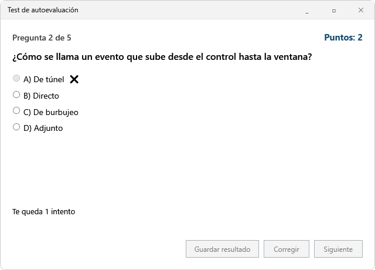
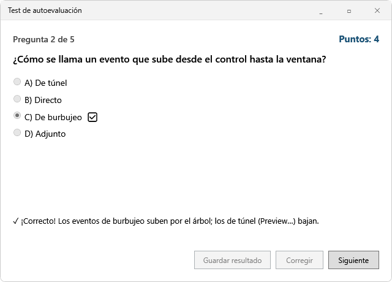
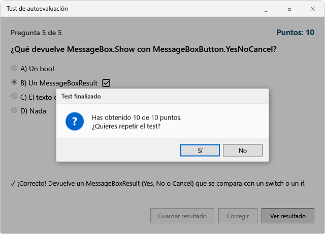
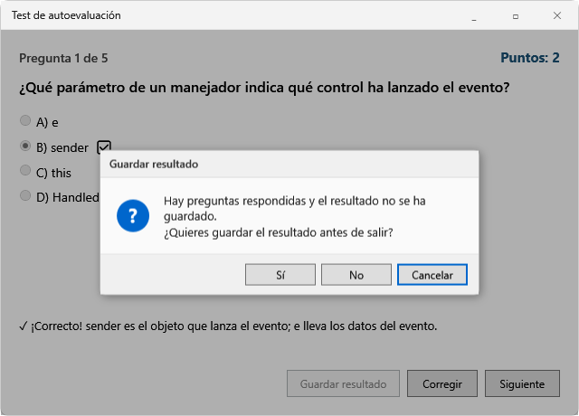

# E04 · Test de autoevaluación

Aplicación interactiva de autoevaluación desarrollada con **WPF**, **.NET 10** y **C#**. Implementa un test de cinco preguntas de opción múltiple con soporte completo para ratón y teclado, gestión de intentos y puntuación proporcional, eventos enrutados con estrategias de burbujeo y túnel, descarte visual contextual, persistencia resiliente de resultados en disco y control seguro del ciclo de vida de la ventana.

---

## Capturas

### 1. Opción fallada en primer intento (desactivada)
Al fallar el primer intento en una pregunta, la opción seleccionada se desmarca, se deshabilita (`IsEnabled = false`) y se marca visualmente con ❌. La interfaz informa mediante `txtResultado` que queda 1 intento y deshabilita `btnCorregir` hasta seleccionar otra opción:



### 2. Pregunta resuelta con explicación
Al acertar (o agotar los dos intentos), la pregunta se resuelve: se suma la puntuación correspondiente (2 puntos en primer intento, 1 punto en segundo intento), se muestra la explicación técnica del banco de preguntas, se deshabilitan todas las opciones y el foco salta automáticamente a `btnSiguiente`:



### 3. Mensaje del final del test
Tras responder a la última pregunta («Ver resultado»), un cuadro de diálogo pregunta al usuario si desea reiniciar el cuestionario. Si elige «No», el resultado final queda fijado en `txtResultado` y se habilita el botón `btnGuardar`:



### 4. Aviso de confirmación al cerrar
Si el usuario intenta cerrar la ventana habiendo respondido preguntas y sin haber guardado el resultado, la aplicación intercepta el evento `Closing` y despliega un `MessageBox` con opciones «Sí», «No» y «Cancelar» (con «Cancelar» como botón por defecto para evitar pérdidas accidentales):



---

## Eventos

| Evento | Dónde se suscribe | Tipo (directo, burbujeo o túnel) | Para qué |
|--------|-------------------|----------------------------------|----------|
| `RadioButton.Checked` (`pnlOpciones_Checked`) | `pnlOpciones` (`StackPanel`) | Burbujeo (`Bubble`) | Activa el botón `btnCorregir` cuando se marca cualquiera de las 4 opciones hijas. Utiliza `e.OriginalSource` para verificar que el emisor original es un `RadioButton`. |
| `MouseRightButtonUp` (`rbOpcion_MouseRightButtonUp`) | `rbOpcionA`, `rbOpcionB`, `rbOpcionC`, `rbOpcionD` (`RadioButton`) | Directo (`Direct`) | Descarta visualmente la opción atenuando su opacidad a `0.4` o la restaura a `1.0` si ya estaba descartada, sin alterar su estado `IsChecked` y actualizando el texto de ayuda. |
| `MouseEnter` (`rbOpcion_MouseEnter`) | `rbOpcionA`, `rbOpcionB`, `rbOpcionC`, `rbOpcionD` (`RadioButton`) | Directo (`Direct`) | Muestra dinámicamente en `txtAyuda` la acción contextual según la opacidad del control: «Clic derecho para descartar la opción X» o «recuperar». |
| `MouseLeave` (`rbOpcion_MouseLeave`) | `rbOpcionA`, `rbOpcionB`, `rbOpcionC`, `rbOpcionD` (`RadioButton`) | Directo (`Direct`) | Limpia el contenido de `txtAyuda` cuando el puntero del ratón abandona el área del control. |
| `PreviewKeyDown` (`Window_PreviewKeyDown`) | `Window` (`MainWindow`) | Túnel (`Tunnel`) | Captura pulsaciones de teclas ('A'-'D' y '1'-'4' tanto alfanuméricas como del teclado numérico) para marcar la opción activa y darle el foco antes de que otros controles las intercepten (`e.Handled = true`). Omite la gestión si `Ctrl` o `Alt` están presionadas para preservar los accesos mnemónicos. |
| `Click` (`btnCorregir_Click`) | `btnCorregir` (`Button`) | Burbujeo (`Bubble`, heredado de `ButtonBase`) | Evalúa la opción marcada frente a la correcta. En el primer intento suma 2 puntos si es correcta o desactiva la opción si falla; en el segundo suma 1 punto o desvela la respuesta correcta. En ambos casos de resolución muestra la explicación y pasa el foco a `btnSiguiente`. |
| `Click` (`btnSiguiente_Click`) | `btnSiguiente` (`Button`) | Burbujeo (`Bubble`, heredado de `ButtonBase`) | Avanza a la siguiente pregunta restableciendo estados y opacidades. En la última pregunta («Ver resultado») muestra un `MessageBox` con opción de reiniciar el test o activar `btnGuardar`. |
| `Click` (`btnGuardar_Click`) | `btnGuardar` (`Button`) | Burbujeo (`Bubble`, heredado de `ButtonBase`) | Ejecuta `GuardarResultado()` para registrar la sesión en `autoevaluacion.txt` y notifica al usuario con un mensaje informativo, desactivándose tras guardar. |
| `Closing` (`Window_Closing`) | `Window` (`MainWindow`) | Directo (`Direct`) | Comprueba si existen preguntas respondidas pendientes de guardar. Si es así, despliega un diálogo de confirmación (Sí/No/Cancelar); si se cancela o si el guardado falla, cancela el cierre (`e.Cancel = true`). |

---

## La ruta del evento Checked

Al colocar un punto de interrupción dentro de `pnlOpciones_Checked` y marcar una opción:

- **¿Qué hay en `sender`?**
  Contiene la referencia al contenedor `pnlOpciones` (de tipo `StackPanel`). `sender` siempre representa el elemento del árbol visual en el que se ha registrado o suscrito el manejador del evento.
- **¿Qué hay en `e.OriginalSource`?**
  Contiene el control exacto donde se originó el evento, es decir, el `RadioButton` específico que el usuario ha seleccionado (por ejemplo `rbOpcionB`).

### ¿Por qué un solo manejador en el panel recibe los Checked de las cuatro opciones?
Porque `RadioButton.Checked` es un **evento enrutado** (*routed event*) configurado con la estrategia de **burbujeo** (`RoutingStrategy.Bubble`). Cuando se activa un `RadioButton`, el evento no se queda en el control emisor, sino que se propaga hacia arriba a través de la jerarquía visual:
$$\text{RadioButton} \longrightarrow \text{StackPanel (pnlOpciones)} \longrightarrow \text{ScrollViewer} \longrightarrow \text{Grid} \longrightarrow \text{Window}$$

Al adjuntar la suscripción en el panel mediante la sintaxis de evento adjunto `RadioButton.Checked="pnlOpciones_Checked"`, cualquier evento `Checked` disparado por cualquiera de sus elementos descendientes sube por el árbol y es capturado por este único manejador en `pnlOpciones`.

### ¿Qué tendrías que escribir sin el burbujeo?
Si `Checked` fuera un evento directo (análogo a `MouseEnter`), el evento solo se dispararía en el propio control que lo emite y nunca alcanzaría al contenedor padre. En ese caso, habría sido necesario:
1. Suscribir el manejador de forma explícita e individual en cada uno de los cuatro botones dentro del XAML:
   ```xml
   <RadioButton x:Name="rbOpcionA" Checked="rbOpcion_Checked" ... />
   <RadioButton x:Name="rbOpcionB" Checked="rbOpcion_Checked" ... />
   <RadioButton x:Name="rbOpcionC" Checked="rbOpcion_Checked" ... />
   <RadioButton x:Name="rbOpcionD" Checked="rbOpcion_Checked" ... />
   ```
2. O bien suscribirlo individualmente cuatro veces desde código C# en el constructor:
   ```csharp
   rbOpcionA.Checked += rbOpcion_Checked;
   rbOpcionB.Checked += rbOpcion_Checked;
   rbOpcionC.Checked += rbOpcion_Checked;
   rbOpcionD.Checked += rbOpcion_Checked;
   ```
El mecanismo de burbujeo permite centralizar la lógica, evitar código redundante y desacoplar los controles hijos del contenedor.

---

## Errores al guardar

### ¿Qué pasa en la comprobación 8 (sin try-catch) y por qué?
Al marcar el archivo `autoevaluacion.txt` con el atributo de **solo lectura** e intentar guardar (por ejemplo, eligiendo «Sí» en el diálogo de cierre de la ventana), el método `File.AppendAllLines()` intenta abrir el fichero con permisos de escritura (`FileAccess.Write`). El sistema operativo deniega la operación y el entorno de ejecución de .NET lanza una excepción de tipo `System.UnauthorizedAccessException` (*Acceso denegado a la ruta*).

Si se retira el bloque `try-catch` de `GuardarResultado()`:
- La excepción no es capturada por ningún manejador en la pila de llamadas.
- La excepción se propaga hacia el despachador de eventos de la aplicación (`DispatcherUnhandledException` / `AppDomain.UnhandledException`).
- La aplicación sufre un **cierre abrupto incontrolado** (*crash*): el proceso finaliza inmediatamente, el usuario pierde el estado de su autoevaluación, no se le muestra ningún aviso descriptivo y la ventana no tiene oportunidad de cancelar el cierre para subsanar el error.

Con el bloque `try-catch`, la aplicación intercepta la excepción de forma controlada, muestra un `MessageBox` explicativo informando de la denegación de acceso, devuelve `false` e impide el cierre de la ventana (`e.Cancel = true`), permitiendo al usuario corregir los permisos o elegir otra acción.

### ¿Qué excepciones capturas y por qué no capturas Exception sin más?
En el método `GuardarResultado()` se utiliza un filtro de excepciones específico:
```csharp
catch (Exception ex) when (ex is IOException or UnauthorizedAccessException)
```
Se capturan únicamente estas dos familias de excepciones:
1. `UnauthorizedAccessException`: lanzada cuando el archivo es de solo lectura, está en un directorio protegido o el usuario carece de privilegios suficientes en el sistema de archivos.
2. `IOException`: lanzada ante problemas físicos o de concurrencia en disco (por ejemplo, el fichero está abierto y bloqueado en modo exclusivo por otro proceso, disco lleno o ruta de red desconectada).

**¿Por qué no capturar `Exception` sin más?**
Capturar la clase base genérica `Exception` es un antipatrón (*catch-all*) que oculta errores de programación graves (*bugs*), tales como `NullReferenceException`, `ArgumentNullException`, `IndexOutOfRangeException` o `OutOfMemoryException`. Si se capturaran de forma indiscriminada:
- Se enmascararían fallos internos del código como supuestos fallos de guardado en disco.
- Se dificultaría gravemente la depuración y resolución de errores lógicos.
- Se violaría el principio de robustez: un programa solo debe capturar las excepciones específicas que prevé y que sabe gestionar de forma segura en ese punto del flujo.

---

## Pruebas realizadas

| # | Qué he hecho | Qué esperaba | Qué ha pasado |
|---|--------------|--------------|---------------|
| 1 | Iniciar la aplicación por primera vez | Ver `Pregunta 1 de 5`, `Puntos: 0`, botón `Corregir` deshabilitado, botón `Siguiente` deshabilitado y botón `Guardar resultado` deshabilitado | Correcto. La interfaz arranca en su estado inicial neutro sin opciones marcadas y con los botones inactivos según especificación. |
| 2 | Pulsar la tecla `B` en la ventana y después `Intro` | La opción B se marca, recibe el foco y habilita `Corregir`. Al pulsar `Intro` (botón por defecto `IsDefault`), se valida la respuesta correcta sumando 2 puntos y mostrando la explicación técnica | Correcto. La tecla B fue capturada por `Window_PreviewKeyDown`, se activó `btnCorregir` vía burbujeo y al pulsar Intro se alcanzó `Puntos: 2` y mensaje `✓ ¡Correcto!`. |
| 3 | Pulsar `Siguiente`, elegir la opción A y pulsar `Corregir`; seguidamente elegir B y corregir | En el primer intento (opción A errónea) debe mostrar «Te queda 1 intento», desmarcar y desactivar la opción A. En el segundo intento (opción B errónea) debe resolver indicando que la correcta era la C, manteniendo los puntos en 2 | Correcto. Tras el primer fallo la opción A quedó desmarcada e inactiva (`IsEnabled = false`); tras el segundo fallo se reveló la respuesta C con su explicación y los puntos permanecieron en 2. |
| 4 | Pulsar `Siguiente`, pulsar la tecla `1` y corregir; después pulsar `4` y corregir | La tecla `1` marca la opción A (falla, opción desactivada); la tecla `4` marca la opción D y corrige acertando en el segundo intento, sumando 1 punto (`Puntos: 3`) | Correcto. El teclado alfanumérico y numérico funcionó con el evento de túnel; el segundo intento sumó 1 punto exacto alcanzando `Puntos: 3`. |
| 5 | Intentar cerrar la ventana con la 'X' superior | Debe abrirse un `MessageBox` con botones Sí, No y Cancelar (Cancelar por defecto). Pulsar Cancelar debe mantener la ventana abierta; pulsar No debe cerrarla | Correcto. `Window_Closing` interceptó el evento, Cancelar impidió el cierre (`e.Cancel = true`) y un posterior intento con «No» cerró la aplicación limpiamente. |
| 6 | Reiniciar el test, responder correctamente las 5 preguntas (B, C, D, A, B) y pulsar «No» en repetir; pulsar `btnGuardar` | Obtener 10 de 10 puntos, diálogo de repetir; al pulsar «No» se habilita `Guardar resultado`. Al pulsar guardar, `autoevaluacion.txt` en Documentos registra la línea de test terminado | Correcto. Se obtuvo 10 de 10 puntos y se guardó en `autoevaluacion.txt` la línea con fecha, hora y texto exacto `10 de 10 puntos · 5 de 5 preguntas (terminado)`. |
| 7 | Marcar `autoevaluacion.txt` como solo lectura, responder la pregunta 1 y cerrar con «Sí»; quitar solo lectura y cerrar con «Sí» | Con solo lectura, debe mostrar error y NO cerrar la ventana. Al quitar solo lectura, debe guardar la línea con `(a medias)` y cerrarse | Correcto. `GuardarResultado()` capturó `UnauthorizedAccessException`, mostró aviso de error y mantuvo abierta la ventana. Al restablecer permisos, guardó `(a medias)` y cerró la ventana. |
| 8 | Quitar el `try-catch` de `GuardarResultado()` y repetir la comprobación 7 con el archivo en solo lectura | La aplicación debe sufrir un cierre abrupto (*crash*) incontrolado por excepción no gestionada | Correcto. La aplicación falló con `Unhandled exception. System.UnauthorizedAccessException: Acceso denegado a la ruta` terminando el proceso bruscamente. Se restauró el `try-catch`. |
| 9 | Colocar un punto de interrupción en `pnlOpciones_Checked` y marcar una opción con el ratón o teclado | Inspeccionar variables en depuración | Correcto. `sender` contiene el contenedor `StackPanel` (`pnlOpciones`) y `e.OriginalSource` contiene la instancia concreta de `RadioButton` seleccionada (`rbOpcionB`). |
| 10 | Con el foco en un botón, pulsar `Alt+C` | Debe ejecutarse la acción de Corregir (si está habilitada) y NO debe marcarse la opción C | Correcto. Gracias a la comprobación de `Keyboard.Modifiers.HasFlag(ModifierKeys.Alt)` en `Window_PreviewKeyDown`, el atajo mnemónico de WPF operó sin interferencias. |
| 11 | Pasar el ratón sobre la opción B, hacer clic derecho y repetir clic derecho; avanzar a otra pregunta | Al pasar el ratón, `txtAyuda` muestra «Clic derecho para descartar la opción B». El clic derecho atenúa la opción (`Opacity = 0.4`), no la marca y cambia la ayuda a «recuperar». El segundo clic derecho la restaura a 1.0. Al cambiar de pregunta, todas las opciones vuelven a opacidad 1.0 | Correcto. La gestión compartida de eventos directos (`MouseRightButtonUp`, `MouseEnter`, `MouseLeave`) operó con precisión y la nueva pregunta reseteó las opacidades a 1.0. |
