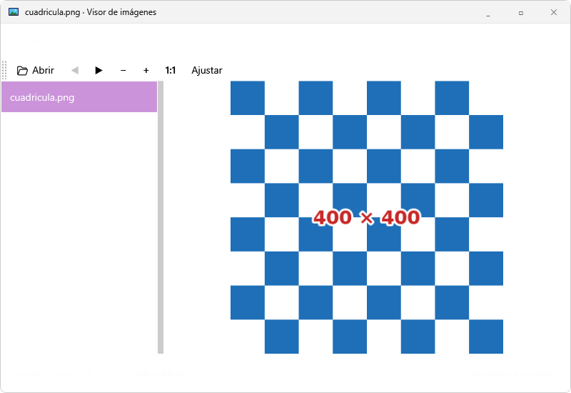
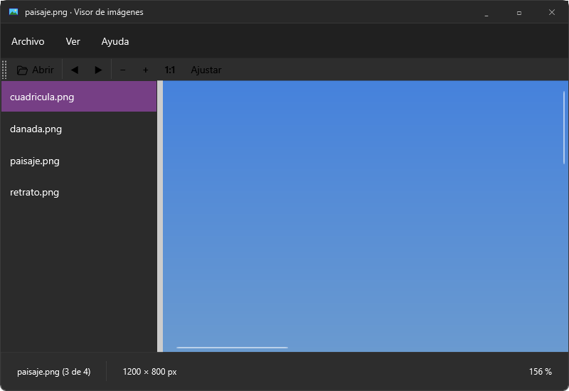
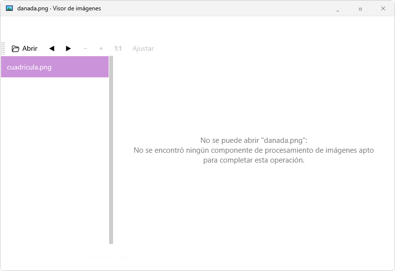
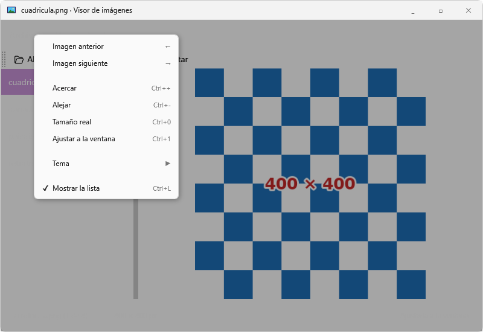
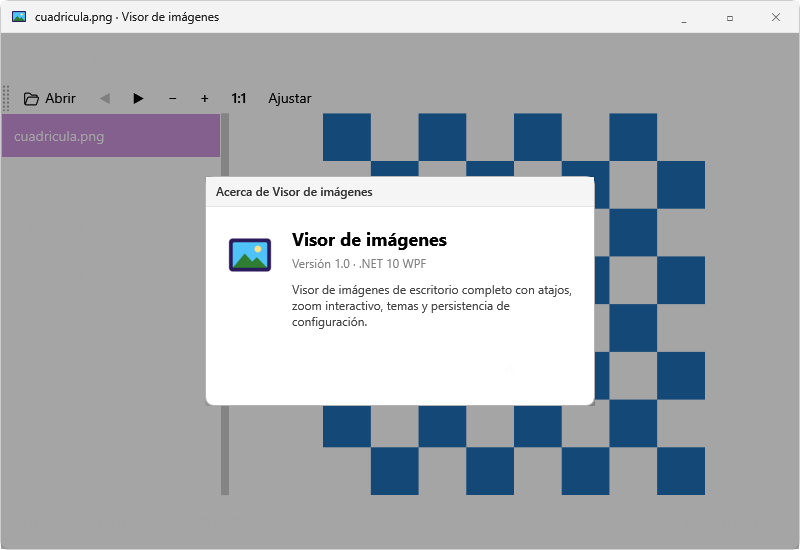

# E05 · Visor de imágenes

Visor de imágenes de escritorio completo desarrollado con **WPF**, **.NET 10** y **C#**. Incorpora navegación rápida de colecciones, zoom interactivo mediante controles, rueda de ratón y atajos de teclado, visualización adaptativa con `ScrollViewer` y `GridSplitter`, diálogo modal accesible «Acerca de», estilos centralizados en diccionarios de recursos, conmutación dinámica de temas mediante Fluent `ThemeMode` y persistencia robusta de configuración de usuario en `%AppData%`.

---

## Capturas

### 1. Con imágenes, tema claro y modo ajustado
Visualización de muestra `cuadricula.png` (400 × 400 px) en tema claro. La barra de estado refleja el nombre, índice en la lista, resolución en píxeles y el estado `Ajustada a la ventana`:



### 2. Tema oscuro y zoom ampliado con barras de desplazamiento
Imagen `paisaje.png` (1200 × 800 px) visualizada bajo el tema oscuro tras dos ampliaciones sucesivas (`156 %`). Se activan automáticamente las barras de desplazamiento horizontal y vertical del `ScrollViewer`:



### 3. Gestión y mensaje de archivo dañado (danada.png)
Al seleccionar `danada.png`, la aplicación captura las excepciones de decodificación y presenta un mensaje explicativo centralizado en `txtMensaje`. Se deshabilitan las opciones de zoom y la aplicación permanece estable y plenamente funcional:



### 4. Menú Ver desplegado con atajos y opciones de zoom
Despliegue del menú `Ver` con sus teclas de acceso mnemónicas, atajos de teclado asociados (`InputGestureText`), opciones de control de zoom y casilla de verificación para mostrar u ocultar la lista de imágenes:



### 5. Ventana modal «Acerca de»
Diálogo modal centrado respecto a la ventana principal (`WindowStartupLocation = CenterOwner`), con icono incrustado, detalles de versión y cierre automático con botón Aceptar, `Intro` o `Esc`:



---

## Menús y barra de herramientas

| Opción | Atajo | Botón | Manejador o comando |
|--------|-------|-------|---------------------|
| Archivo > Abrir imágenes… | `Ctrl+O` | Abrir | `ApplicationCommands.Open` → `Abrir_Executed` |
| Archivo > Cerrar todas | `Ctrl+W` | — | `CerrarTodas_Click` |
| Archivo > Salir | `Alt+F4` | — | `Salir_Click` |
| Ver > Imagen anterior | `←` | `◀` (`btnAnterior`) | `Anterior_Click` |
| Ver > Imagen siguiente | `→` | `▶` (`btnSiguiente`) | `Siguiente_Click` |
| Ver > Acercar | `Ctrl++` | `+` (`btnAcercar`) | `Acercar_Click` |
| Ver > Alejar | `Ctrl+-` | `−` (`btnAlejar`) | `Alejar_Click` |
| Ver > Tamaño real | `Ctrl+0` | `1:1` (`btnTamanoReal`) | `TamanoReal_Click` |
| Ver > Ajustar a la ventana | `Ctrl+1` | `Ajustar` (`btnAjustar`) | `Ajustar_Click` |
| Ver > Tema > Claro | — | — | `mnuTema_Click` |
| Ver > Tema > Oscuro | — | — | `mnuTema_Click` |
| Ver > Tema > Del sistema | — | — | `mnuTema_Click` |
| Ver > Mostrar la lista | `Ctrl+L` | — | `MostrarLista_Click` |
| Ayuda > Acerca de… | `F1` | — | `AcercaDe_Click` |

### ¿Cómo decides qué opciones están desactivadas?
La habilitación e inhabilitación de los controles se centraliza en el método `ActualizarEstadoControles()`, el cual es invocado tras abrir imágenes, al cambiar de selección, al cerrar la colección o cuando ocurre un error de lectura:
1. **Sin imágenes cargadas:** Se desactivan todas las opciones salvo *Abrir imágenes…* y *Salir* (`mnuCerrarTodas`, navegación y zoom inactivos).
2. **En la primera imagen (`_indiceActual == 0`):** La opción *Imagen anterior* (`mnuAnterior` y `btnAnterior`) queda deshabilitada.
3. **En la última imagen (`_indiceActual == _rutasImagenes.Count - 1`):** La opción *Imagen siguiente* (`mnuSiguiente` y `btnSiguiente`) queda deshabilitada.
4. **Con imagen dañada o formato no válido:** Si la imagen falla al abrirse (`_imagenCargadaCorrectamente == false`), todas las opciones de zoom (*Acercar*, *Alejar*, *Tamaño real* y *Ajustar*) se desactivan automáticamente tanto en el menú como en la barra de herramientas.

### ¿Por qué Abrir usa un comando predefinido y no un Click?
El uso de `ApplicationCommands.Open` en lugar de un manejador de evento `Click` tradicional aporta ventajas de arquitectura en WPF:
- **Desacoplamiento semántico:** El comando modela la acción abstracta de apertura de archivos independientemente de la vista o del elemento que la invoque.
- **Enlace múltiple sin redundancia:** Permite que el `MenuItem` del menú principal y el botón correspondiente de la barra de herramientas ejecuten la misma lógica de negocio compartiendo el mismo enlace (`CommandBinding`), sin duplicar código ni suscripciones individuales.
- **Atajos de teclado estandarizados:** Los comandos enrutados estándar de WPF incorporan de forma predeterminada sus propios `InputGestures` (como `Ctrl+O` en `Open`), permitiendo que el atajo sea reconocido globalmente por el sistema de foco sin necesidad de capturar manualmente la tecla en `PreviewKeyDown`.

---

## Recursos y estilos

### Contenido de `Recursos/Estilos.xaml` y uso de recursos
El diccionario de recursos define los estilos y pinceles compartidos por toda la aplicación:
1. `BotonBarra`: Aplicado a todos los botones de la barra de herramientas. Define dimensiones uniformes, cursor interactivo, desencadenador visual para atenuar la opacidad al 40% (`Opacity = 0.4`) cuando `IsEnabled = False` y la propiedad adjunta `ToolTipService.ShowOnDisabled = True` para que el mensaje de ayuda y su atajo sigan siendo visibles con el botón inactivo.
2. `TextoEstado`: Aplicado a los bloques de texto de la barra de estado inferior (`txtEstadoNombre`, `txtEstadoTamano`, `txtEstadoZoom`), asegurando alineación y tipografía homogéneas.
3. `MensajeCentral`: Aplicado a `txtMensaje` para estructurar y centrar los avisos en el área de visualización.
4. `ColorMensajeCentral`: Brocha de color utilizada para garantizar la legibilidad del texto central ante cambios de tema.

### ¿Dónde usas StaticResource y dónde DynamicResource, y por qué?
- **`StaticResource`:** Se emplea para asociar los estilos `BotonBarra`, `TextoEstado` y `MensajeCentral` a los controles XAML. Estos estilos se resuelven de forma estática una sola vez durante la carga inicial del árbol de elementos visuales, lo que reduce la sobrecarga de evaluación y maximiza el rendimiento.
- **`DynamicResource`:** Se emplea en la propiedad `Foreground` del estilo `MensajeCentral` (`Foreground="{DynamicResource ColorMensajeCentral}"`). A diferencia de los recursos estáticos, `DynamicResource` mantiene una referencia viva a la tabla de recursos; al conmutar entre el tema claro y el tema oscuro en tiempo de ejecución, el color de la brocha cambia y el texto central se actualiza de manera inmediata sin necesidad de recrear la ventana ni recargar la vista.

### Icono visor.ico: configuración y diferencia entre Icon y ApplicationIcon
El archivo `visor.ico` (con resoluciones de 16, 32, 48 y 256 píxeles) se aloja en `Imagenes/visor.ico` y se declara como recurso de compilación en `VisorImagenes.csproj` mediante `<Resource Include="Imagenes\visor.ico" />`.

- **`Icon` (propiedad de `Window` en XAML):** Representa el icono gráfico de la ventana en tiempo de ejecución. Es el icono que dibuja Windows en la esquina superior izquierda de la barra de título, en la barra de tareas mientras la aplicación se encuentra en ejecución y en el selector de aplicaciones activas (`Alt+Tab`).
- **`ApplicationIcon` (propiedad en el `.csproj`):** Es el icono que el compilador incrusta en los metadatos y encabezados del archivo binario ejecutable (`VisorImagenes.exe`). Es el icono que muestra el Explorador de archivos de Windows en la carpeta `bin/` y el que se adopta al crear accesos directos en el sistema operativo.

---

## Configuración del usuario

### 1. Contenido de `configuracion.json`
El archivo se almacena en `%AppData%\VisorImagenes\configuracion.json`:

```json
{
  "Left": 150,
  "Top": 120,
  "Width": 900,
  "Height": 600,
  "AnchoLista": 220,
  "Maximizada": false,
  "Tema": "Oscuro",
  "MostrarLista": false,
  "UltimaCarpeta": "C:\\Users\\jorge\\OneDrive\\Desktop\\C#\\E05-VisorImagenes\\muestras",
  "UltimaImagen": "C:\\Users\\jorge\\OneDrive\\Desktop\\C#\\E05-VisorImagenes\\muestras\\cuadricula.png",
  "UltimoZoom": 1.0,
  "UltimoZoomAjustado": true
}
```

### 2. Ciclo de lectura/escritura y uso de RestoreBounds
- **Momento de lectura:** Se ejecuta en el constructor de `MainWindow` mediante `ServicioConfiguracion.Cargar()`, justo tras `InitializeComponent()`, aplicando inmediatamente las dimensiones, coordenadas, ancho de panel, tema y visibilidad de controles.
- **Momento de guardado:** Se ejecuta en el manejador del evento `Window_Closing` invocando `ServicioConfiguracion.Guardar(config)`.
- **Por qué guardar `RestoreBounds` al estar maximizada:** Cuando la ventana se encuentra maximizada (`WindowState == WindowState.Maximized`), las propiedades convencionales `Left`, `Top`, `Width` y `Height` devuelven las dimensiones totales de la pantalla actual. Si se persistieran dichos valores, al reiniciar la ventana perdería la memoria de su tamaño previo. La propiedad `RestoreBounds` almacena el tamaño y la posición exacta que la ventana poseía en modo normal antes de ser maximizada, permitiendo que al restaurarla recupere con precisión el tamaño personalizado por el usuario.

### 3. ¿Qué pasa si el fichero no existe o está dañado?
El servicio `ServicioConfiguracion` encapsula la deserialización y lectura en bloques `try-catch`:
- Si el archivo no existe, `Cargar()` devuelve inmediatamente una nueva instancia de `ConfiguracionVisor` inicializada con valores por defecto óptimos (800 × 550, tema del sistema, lista visible).
- Si el archivo existe pero contiene datos truncados, caracteres inválidos o JSON corrupto, la excepción `JsonException` es capturada sin propagarse, devolviendo la configuración por defecto y permitiendo que la aplicación arranque limpiamente sin interrupciones.
- Si ocurre algún error de permisos al guardar durante el cierre de la ventana, la excepción se captura para evitar que un fallo de E/S impida cerrar la aplicación.

---

## Pruebas realizadas

| # | Qué he hecho | Qué esperaba | Qué ha pasado |
|---|--------------|--------------|---------------|
| 1 | Iniciar la aplicación sin imágenes | Ver el texto informativo central, estado «Sin imágenes» en la barra inferior y todas las opciones deshabilitadas salvo *Abrir* y *Salir*. Ver el `ToolTip` al pasar sobre botones inactivos | Correcto. La aplicación arranca en estado neutro, las opciones de navegación y zoom están deshabilitadas y los ToolTips se muestran gracias a `ToolTipService.ShowOnDisabled`. |
| 2 | Pulsar `Ctrl+O` y seleccionar las cuatro imágenes de muestra | Cargar las cuatro muestras en `lstImagenes`, mostrar la primera ajustada a la ventana y actualizar el título y la barra de estado con nombre, posición y dimensiones | Correcto. Se listaron los 4 nombres, `cuadricula.png` se mostró con `400 × 400 px` y `Ajustada a la ventana`, con *Anterior* desactivado y *Siguiente* habilitado. |
| 3 | Seleccionar `danada.png` en la lista y navegar con `→` hasta el final | Mostrar en `txtMensaje` la explicación del error de formato, desactivar las opciones de zoom y mantener la estabilidad de la app. En la última imagen, *Siguiente* debe quedar inactivo | Correcto. `txtMensaje` detalló el error de componente de imágenes, las herramientas de zoom se deshabilitaron y en la imagen 4 (`retrato.png`) el botón *Siguiente* se desactivó. |
| 4 | Con `cuadricula.png`, pulsar `1:1`, pulsar `Ctrl++` dos veces y usar rueda | Zoom en `100 %` mostrando cuadros de 50 px exactos; dos aumentos alcanzan `156 %` mostrando barras de desplazamiento. `Ctrl` + rueda aleja y la rueda sola desplaza verticalmente | Correcto. Modo 1:1 fijó 400 × 400 px y 100%; los dos incrementos por 1.25 alcanzaron el 156% activando barras de desplazamiento; la rueda con Ctrl alteró el zoom y sin Ctrl desplazó el visor. |
| 5 | Pulsar `Ctrl+-` sucesivamente y luego pulsar `Ctrl+1` | El zoom decrece hasta alcanzar el tope inferior del `10 %` sin reducirse más. Al pulsar `Ctrl+1`, la imagen vuelve a `Ajustada a la ventana` sin barras de desplazamiento | Correcto. El factor de escala se detuvo en el límite mínimo del 10%; `Ctrl+1` reactivó el ajuste uniforme deshabilitando las barras de desplazamiento. |
| 6 | Acceder a *Ver > Tema > Oscuro* | La aplicación adopta el tema oscuro, el mensaje central mantiene legibilidad óptima y únicamente la opción *Oscuro* queda marcada en el menú | Correcto. `ThemeMode.Dark` aplicó el estilo visual oscuro en controles y marcos, contrastando correctamente con `ColorMensajeCentral`. |
| 7 | Desmarcar *Mostrar la lista* y volver a marcarla | La imagen pasa a ocupar todo el ancho disponible ocultando lista y separador. Al volver a activarla, la lista recupera su ancho previo | Correcto. La columna de la lista y el separador colapsaron a 0 y al reactivarse recuperaron el ancho almacenado en memoria. |
| 8 | Abrir *Ayuda > Acerca de…* e interactuar | La ventana modal se abre centrada impidiendo usar la principal; se cierra con botón Aceptar, con `Intro` o pulsando `Esc` | Correcto. La ventana modal bloqueó la ventana dueña y se cerró limpiamente con `Esc` e `Intro` sin requerir código C# adicional. |
| 9 | Modificar posición, tamaño, tema oscuro y ocultar lista; cerrar y reiniciar | La configuración se persiste en `configuracion.json`. Al volver a abrir, recupera tamaño, tema y estado. Al maximizar, cerrar y reabrir, conserva la restauración | Correcto. Los parámetros se guardaron en `%AppData%` y se recuperaron íntegramente. `RestoreBounds` preservó las dimensiones previas a la maximización. |
| 10 | Abrir en la carpeta de muestras; corromper `configuracion.json` y ejecutar | El diálogo inicia en la última carpeta usada. Ante un JSON dañado, la aplicación arranca con los valores predeterminados sin lanzar errores | Correcto. `OpenFileDialog` recordó la ruta de las muestras y tras inyectar texto no válido en el JSON la aplicación inició normalmente con valores por defecto. |
| 11 | Verificar iconos en barra de título, barra de tareas, `Alt+Tab` y ejecutable | El icono del visor se visualiza en todas las superficies de la ventana y en `VisorImagenes.exe` en el Explorador de archivos | Correcto. `Icon` vistió la interfaz gráfica y `ApplicationIcon` quedó incrustado en el ejecutable de 32x32 y múltiples resoluciones. |
